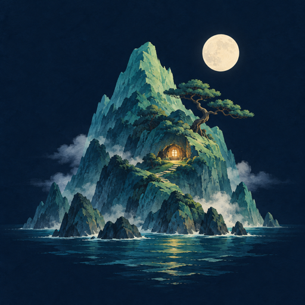

# Hi, I'm jggagi.

**Build small. Understand deeply.**

I explore ideas by turning them into useful tools, interactive experiments, and visual stories.

把好奇心变成能用的工具、能玩的实验和能看见的故事。

 

### What I explore · 探索方向

| | What draws me in |
| :--- | :--- |
| **Local-first tools & AI** 本地优先工具与 AI | Useful software that keeps people in control. 让工具有用，也让使用者保有选择。 |
| **Interactive worlds & learning** 互动世界与学习 | Small worlds and hands-on experiments that make ideas tangible. 用可探索的小世界，把抽象想法变得具体。 |
| **Visual storytelling** 视觉叙事 | Images, motion, and sound that help an idea take shape. 用画面、动作和声音，让想法慢慢成形。 |

### How I build · 构建方式

- **Start small, make it work.** Begin with something usable, then learn from real use. 从一个能用的小版本开始。
- **Keep it understandable.** Favor clear behavior, inspectable state, and reversible changes. 让过程看得清，修改可回退。
- **Design for privacy.** Keep data boundaries and user choices explicit. 把隐私边界与用户选择放进设计。

---

*Always learning through making. · 在动手中理解，在迭代中改进。*
